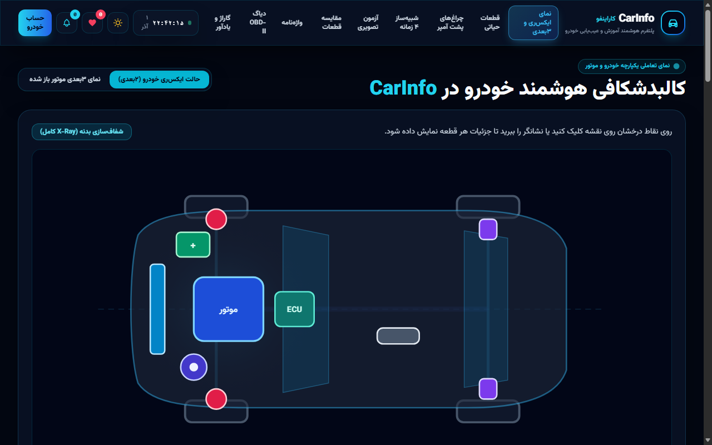

# CarInfo — کاراینفو

مرجع تعاملی آموزش قطعات خودرو، چراغ‌های هشدار پشت آمپر و عیب‌یابی اولیه خودرو — پیاده‌سازی‌شده با Django و SQLite با ظاهر شیشه‌ای (Glassmorphism) و راست‌به‌چپ.

[](https://www.python.org/)
[](https://www.djangoproject.com/)
[](https://www.sqlite.org/)
[](https://developer.mozilla.org/en-US/docs/Web/HTML)
[](https://developer.mozilla.org/en-US/docs/Web/CSS)
[](https://developer.mozilla.org/en-US/docs/Web/JavaScript)



## معرفی

CarInfo یک وب‌سایت آموزشی و تعاملی برای رانندگان و علاقه‌مندان خودرو است. تمام داده‌های سایت (قطعات، چراغ‌های هشدار، کدهای دیاگ، واژه‌نامه و سؤالات آزمون) از دیتابیس خوانده می‌شوند و از طریق پنل مدیریت Django بدون تغییر کد قابل ویرایش هستند.

## امکانات

- دانشنامه قطعات خودرو با جستجو، فیلتر دسته‌بندی و صفحه جزئیات هر قطعه
- نمای ایکس‌ری دوبعدی و مدل سه‌بعدی موتور با قابلیت باز/بسته شدن قطعات (Three.js)
- شبیه‌ساز چرخه ۴ زمانه موتور احتراقی
- آزمون تصویری شناخت قطعات با امتیازدهی
- استودیوی مقایسه دو قطعه
- واژه‌نامه تخصصی خودرو با جستجوی زنده
- جستجوی کدهای خطای دیاگ OBD-II (مانند P0300 و P0420)
- مقالات و آموزش‌های نگهداری خودرو
- حساب کاربری: ثبت‌نام، ورود و علاقه‌مندی قطعات
- گاراژ شخصی: پروفایل خودرو و یادآورهای سرویس با CRUD کامل
- مکانیک هوشمند (چت‌بات)، تم تیره/روشن و طراحی واکنش‌گرا

## زبان‌ها و تکنولوژی‌ها

| زبان / تکنولوژی | کاربرد |
|---|---|
| Python 3.14 | بک‌اند، منطق و APIها |
| Django 6.1 | فریم‌ورک، ORM، قالب‌ها و پنل مدیریت |
| SQLite | دیتابیس |
| HTML | قالب‌های صفحات (Django Templates) |
| CSS + Tailwind CSS | استایل شیشه‌ای، تم تیره/روشن و واکنش‌گرایی |
| JavaScript + Three.js | تعاملات صفحه، شبیه‌ساز و نمای سه‌بعدی |

## معماری

```
مرورگر (HTML/CSS/JS + Three.js)
      │
      ├── صفحات رندرسرور (Django Templates)
      ├── داده‌ها با json_script از دیتابیس
      └── fetch JSON با CSRF برای کاربر واردشده
                  │
                  ▼
            Django (config + 7 اپ)
                  │
                  ├── ORM ──── SQLite (db.sqlite3)
                  ├── Admin ── /admin/
                  └── Media ── /media/ (تصاویر آپلودشده)
```

## نصب و اجرا

```bash
python -m venv venv
venv\Scripts\activate              # ویندوز
python -m pip install -r requirements.txt

python manage.py migrate           # ساخت جداول
python manage.py seed_data         # داده‌های اولیه (قطعات، چراغ‌ها، کدها، آزمون...)
python manage.py createsuperuser   # کاربر مدیر

python manage.py runserver
```

- سایت: `http://127.0.0.1:8000`
- پنل مدیریت: `http://127.0.0.1:8000/admin`

کاربر مدیر دموی توسعه: `admin` / `carinfo-admin-2026` — پس از استقرار حتماً تغییر دهید.

## آدرس‌های سایت

| آدرس | صفحه |
|---|---|
| `/` | صفحه اصلی (نمای ایکس‌ری، شبیه‌ساز، آزمون، مقایسه و گاراژ) |
| `/parts/` و `/parts/<slug>/` | فهرست و جزئیات قطعات |
| `/guides/` و `/guides/<slug>/` | آموزش‌های نگهداری |
| `/glossary/` | واژه‌نامه تخصصی |
| `/warnings/` | چراغ‌های هشدار پشت آمپر |
| `/obd/` | جستجوی کدهای خطای دیاگ |
| `/quiz/` | آزمون تصویری |
| `/about/` و `/contact/` | درباره ما و تماس |
| `/accounts/login/` و `/accounts/register/` | ورود و ثبت‌نام |
| `/profile/` | پروفایل کاربر و خودرو |
| `/favorites/` | علاقه‌مندی‌ها |
| `/maintenance/` | یادآورهای سرویس |

## ساختار پروژه

```text
carinfo/
├── config/          # تنظیمات پروژه و URLهای ریشه
├── core/            # صفحه اصلی، داده‌های مشترک و دستور seed
├── parts/           # قطعات و دسته‌بندی‌ها
├── guides/          # آموزش‌ها و واژه‌نامه
├── warning_lights/  # چراغ‌های هشدار و کدهای OBD-II
├── quiz/            # سؤالات آزمون تصویری
├── accounts/        # ورود، ثبت‌نام، پروفایل و علاقه‌مندی‌ها
├── maintenance/     # یادآورهای سرویس و گاراژ
├── templates/       # قالب‌های صفحات
├── static/          # CSS و JavaScript
└── media/           # تصاویر آپلودشده (در gitignore)
```

## نکات امنیتی

- کلید `SECRET_KEY` از متغیر محیطی `DJANGO_SECRET_KEY` خوانده می‌شود (مقدار پیش‌فرض فقط برای توسعه است).
- همه فرم‌ها و APIها با CSRF محافظت می‌شوند.
- صفحات خصوصی (پروفایل، علاقه‌مندی‌ها، یادآورها) فقط برای کاربران واردشده قابل دسترسی است و هر کاربر فقط داده‌های خودش را می‌بیند.
